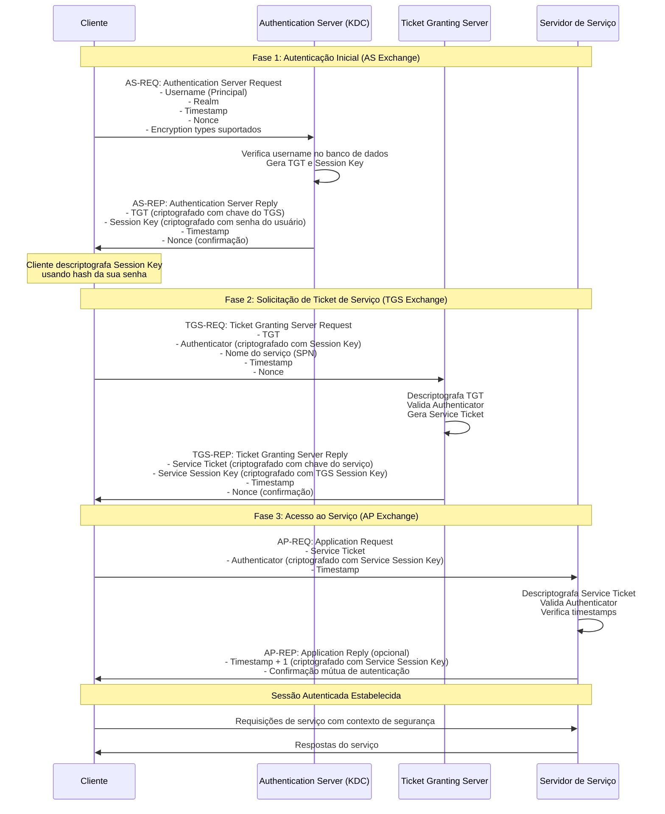
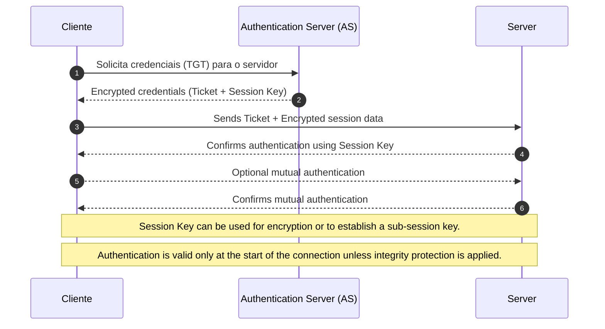
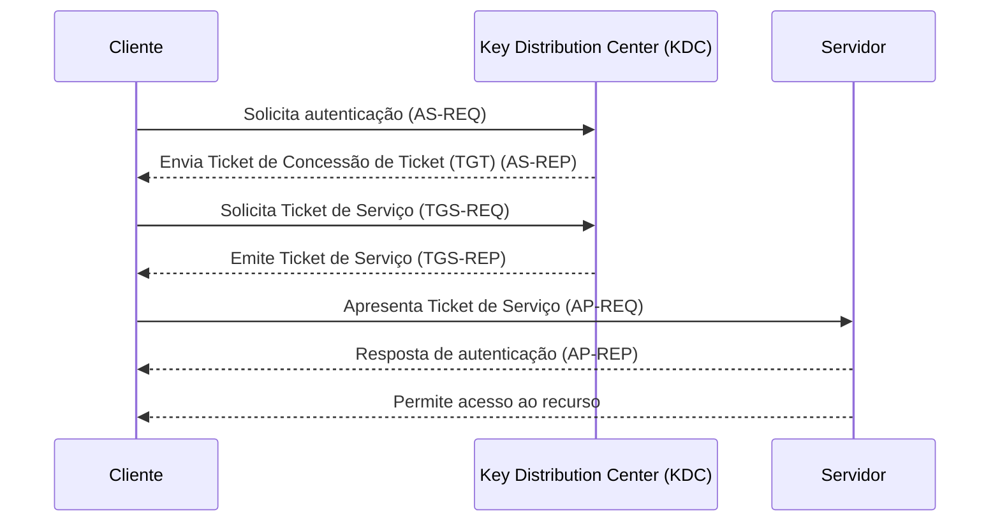

---
title: "[PRODUÇÃO] Kerberos: Introdução e Conceito"
date: 2025-05-24T13:06:33-03:00
draft: false
description: "Aprenda no detalhe os fundamentos do protocolo Kerberos: sua origem, principais componentes, fluxo de autenticação, uso de criptografia e conceitos-chave que são os pilares de toda rede corporativa atualmente."
noindex: false
featured: false
pinned: false
comments: true
series:
 - Kerberos
categories:
#  - 
 - publicar
tags:
#  - 
images:
authors:
 - sandson

---
## **TL;DR**

## **1. Introdução**

Este é o primeiro artigo de uma série dedicada exclusivamente a ataques e defesa em ambiente Windows. Neste artigo, vamos explorar os princípios básicos, a arquitetura dos componentes e o fluxo de autenticação, oferecendo uma base sólida para quem deseja entender a teoria de como o protocolo Kerberos funciona.

O conteúdo deste artigo tem como foco os fundamentos e é completamente teórico e voltado ao aprofundamento acadêmico. A leitura pode exigir atenção, mas, ao final, você terá um entendimento claro e estruturado sobre o protocolo. Particularmente falando, acredito ser de suma importância antes de avançarmos para temas como ataque e defesa, que serão abordados nas próximas sessões.

## **2. O que é o Kerberos?**

O protocolo Kerberos é um sistema de autenticação de rede que foi projetado para fornecer segurança ao ambiente corporativo. Desenvolvido pelo MIT na década de 80, baseada em criptografia simétrica e em operação com base em um modelo centralizado utilizando um **Key Distribution Center (KDC)** para autenticação de usuários.

> Muito embora o protocolo Kerberos seja, originalmente, de padrão aberto, a Microsoft implementou sua própria versão proprietária do protocolo no Active Directory. Esta versão é baseada no Kerberos 5, mas inclui extensões específicas da Microsoft, como [MS-PAC (Privilege Attribute Certificate)](https://learn.microsoft.com/en-us/openspecs/windows_protocols/ms-pac/166d8064-c863-41e1-9c23-edaaa5f36962), por exemplo.

O nome “Kerberos” faz referência ao cão de três cabeças da mitologia grega que guardava a entrada do submundo, simbolizando os três componentes principais do protocolo: o cliente, o servidor e o KDC.

## **3. Componentes do Kerberos**

### 3.1. Desenho conceitual

### 1.2. O papel do Kerberos na segurança de redes

O principal objetivo do Kerberos é permitir que um usuário se autentique de forma segura em vários serviços de rede sem a necessidade de enviar sua senha diretamente para cada serviço. Isso é alcançado através de um sistema baseado em tickets criptográficos que representam as credenciais do usuário.

## **2. Como o Kerberos funciona?**

**O processo de autenticação do Kerberos envolve várias etapas e componentes:**

- **Autenticação inicial:** O cliente envia uma solicitação ao KDC contendo seu nome de usuário.
- **Emissão do Ticket Granting Ticket (TGT):** O KDC responde com um TGT criptografado usando a chave secreta do cliente, que pode ser derivada de sua senha. O cliente deve descriptografar esse TGT para continuar o processo.
- **Solicitação de serviços:** Com o TGT em mãos, o cliente pode solicitar tickets de serviço ao KDC para acessar serviços específicos da rede.
- **Emissão do Service Ticket:** O KDC emite um ticket de serviço criptografado com a chave secreta do serviço de destino.
- **Acesso ao serviço:** O cliente apresenta o ticket de serviço ao servidor de destino, que o valida e permite o acesso ao recurso solicitado.

Diagrama ilustrando o processo:

Arquitetura do Kerberos

A arquitetura do Kerberos é composta por três elementos principais:

1. Key Distribution Center (KDC)

O KDC é o componente central do Kerberos, responsável por autenticar os clientes e emitir os tickets necessários para acesso a serviços. Ele é dividido em duas partes:

Authentication Server (AS): Responsável por autenticar o cliente inicialmente e emitir o Ticket Granting Ticket (TGT).

Ticket Granting Server (TGS): Responsável por emitir tickets de serviço com base no TGT apresentado pelo cliente.

2. Ticket Granting Ticket (TGT)

O TGT é um ticket temporário que permite ao cliente solicitar outros tickets de serviço sem precisar se autenticar novamente. Ele possui um tempo de validade limitado e é criptografado usando a chave do TGS.

3. Service Tickets

Os Service Tickets são usados para acessar serviços específicos na rede. Cada ticket é criptografado com a chave secreta do serviço de destino, garantindo que apenas o serviço pretendido possa validá-lo.

Protocolos de autenticação de rede: Kerberos vs NTLM

NTLM (NT LAN Manager)

O NTLM é um protocolo de autenticação legão utilizado em redes Windows. Ele se baseia em um mecanismo de desafio e resposta para autenticar o cliente, mas apresenta várias limitações de segurança, como a suscetibilidade a ataques de relay e brute force.

Comparação entre Kerberos e NTLM

Característica

Kerberos

NTLM

Mecanismo de autenticação

Baseado em tickets

Desafio e resposta

Segurança

Mais seguro

Menos seguro

Performance

Melhor em grandes ambientes

Menos eficiente

Suporte a SSO

Sim

Limitado

Suscetibilidade a ataques

Menos suscetível

Mais suscetível

O papel do Kerberos em ambientes corporativos e redes de domínio

Em ambientes corporativos, especialmente aqueles que utilizam o Active Directory da Microsoft, o Kerberos é o protocolo padrão de autenticação. Ele permite que usuários acessem recursos de rede de forma transparente após a autenticação inicial no domínio.

Algumas das vantagens do uso do Kerberos em redes de domínio incluem:

Segurança aprimorada: A utilização de tickets criptografados reduz a exposição de credenciais.

Suporte a Single Sign-On (SSO): Os usuários precisam se autenticar apenas uma vez para acessar múltiplos serviços.

Eficiência: Reduz a carga de trabalho nos servidores, uma vez que as credenciais são reutilizadas através de tickets.

Conclusão

O Kerberos é um componente essencial para a segurança de redes modernas, oferecendo uma solução escalável e segura para a autenticação de usuários e serviços. Sua adoção ampla em ambientes corporativos, especialmente em redes de domínio Windows, reflete sua eficácia e confiabilidade.

Embora seja mais complexo que outros protocolos, como o NTLM, o Kerberos oferece benefícios significativos em termos de segurança e performance, tornando-se a escolha ideal para organizações que buscam proteger seus recursos de rede.

## **Referências**
- [\[MS-PAC\]: Privilege Attribute Certificate Data Structure](https://learn.microsoft.com/en-us/openspecs/windows_protocols/ms-pac/166d8064-c863-41e1-9c23-edaaa5f36962)
- [Kerberos Authentication Overview](https://learn.microsoft.com/pt-br/windows-server/security/kerberos/kerberos-authentication-overview)
- [How Does Kerberos Work? The Authentication Protocol Explained - **REMOVER**](https://www.freecodecamp.org/news/how-does-kerberos-work-authentication-protocol/)
- [RFC 4120 - The Kerberos Network Authentication Service (V5), July 2005](https://www.rfc-editor.org/info/rfc4120)
- 

Imagine que você é o Suporte de TI e, para acessar a sala de servidores, sala do financeiro, sala do RH, você precisa provar que é realmente você. Mas, ao invés de mostrar seu rosto toda hora, a empresa te dá um crachá que diz quem você é e onde pode ir e com isso acessar essas salas.

Esse cartão só é dado por uma pessoa de confiança, no caso o RH. E toda vez que você precisar usar uma das salas, você usa o crachá.

Esse é o Kerberos, um sistema que te dá um “crachá de acesso" (chamado de ticket) para provar que você é você, e que você tem permissão para fazer algo em uma rede de computadores, mas por tempo limitado.