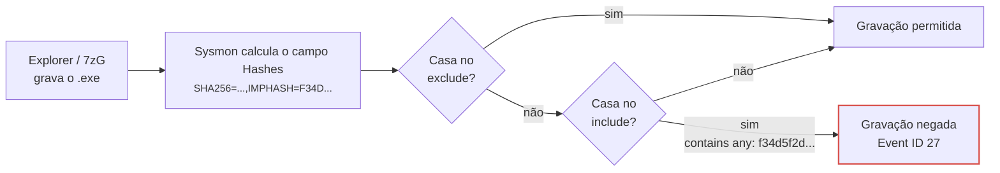
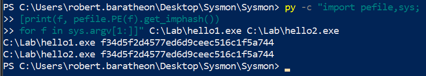
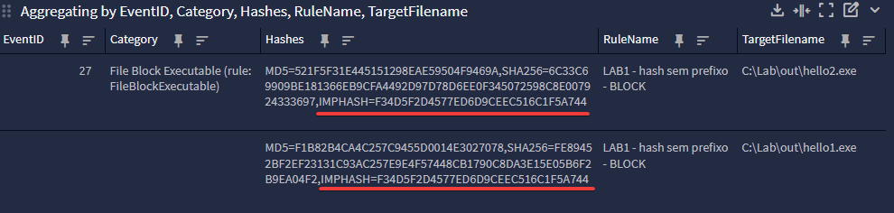
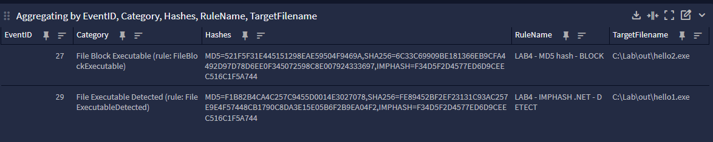

# 1. Introdução

O Sysmon calcula hashes de arquivos em vários eventos (criação de processo, carga de drivers e DLLs, gravação e exclusão de executáveis) e permite usar esses valores tanto para registrar quanto para impedir a gravação de executáveis (a partir da versão 14). Três algoritmos são usados com frequência nessas regras: MD5, SHA-256 e IMPHASH.

MD5 e SHA-256 são calculados sobre o conteúdo integral do arquivo e identificam uma versão exata. O IMPHASH é calculado sobre a tabela de importações de um executável PE e indica semelhança estrutural entre binários. Binários sem relação nenhuma podem ter o mesmo IMPHASH: todo executável .NET Framework compilado apenas em IL (Intermediate Language) importa a mesma função, `mscoree.dll!_CorExeMain`, e por isso todos compartilham o valor `f34d5f2d4577ed6d9ceec516c1f5a744`.

# 2. Como o Sysmon calcula e expõe hashes

O Sysmon calcula apenas os algoritmos listados em `<HashAlgorithms>` e grava todos eles em um único campo de texto, `Hashes`, no formato `ALG=VALOR` separado por vírgulas:

```xml
<!-- configuração típica -->
<HashAlgorithms>MD5,sha256,imphash</HashAlgorithms>
```

```text
Hashes: MD5=…,SHA256=…,IMPHASH=…
```
Valores aceitos: `MD5`, `SHA1`, `SHA256`, `IMPHASH` ou `*` (todos). Toda regra que filtra por `Hashes` opera sobre essa string concatenada, não sobre campos separados. Se o IMPHASH não estiver em `<HashAlgorithms>`, ele não aparece no campo e nenhuma regra casa com ele. Se estiver, inclusive via `*`, qualquer valor de 32 caracteres hexadecimais numa regra pode casar com ele.

Eventos relevantes para este artigo:

| EID | Evento | O que é hasheado |
| --- | --- | --- |
| 1 | ProcessCreate | a imagem do processo criado |
| 6 | DriverLoad | o driver carregado |
| 7 | ImageLoad | a DLL carregada |
| 27 | FileBlockExecutable | o executável cuja gravação foi bloqueada |
| 29 | FileExecutableDetected | o executável detectado na gravação |

O campo `Hashes` também existe nos eventos 15, 23, 24, 26 e 28.

O IMPHASH só existe para arquivos PE. Para conteúdo sem tabela de importações, o Sysmon emite `IMPHASH=00000000000000000000000000000000`, o que já é, por si só, um valor que colide para todo PE sem imports.

# 3. O que cada hash identifica

## 3.1. MD5
 
O MD5 gera um resumo de 128 bits (32 caracteres hexadecimais) a partir de todo o conteúdo do arquivo. Está quebrado criptograficamente desde 2004. Hoje é possível gerar colisões a partir de um prefixo escolhido, técnica que o malware Flame usou em 2012 para forjar um certificado de assinatura de código da Microsoft. Colisões acidentais continuam improváveis, então uma lista de IOCs em MD5 ainda serve para reconhecer amostras conhecidas. O risco aparece quando o adversário produz a colisão de propósito.
 
No Sysmon, o MD5 tem exatamente o mesmo tamanho do IMPHASH. Um valor de 32 caracteres sem o prefixo `MD5=` ou `IMPHASH=` pode ser qualquer um dos dois.
 
## 3.2. SHA-256
 
O SHA-256 também é calculado sobre todo o arquivo, gera um resumo de 256 bits (64 caracteres hexadecimais) e não tem colisões conhecidas. Alterar um único byte, seja um timestamp, a assinatura digital ou um ícone, produz um hash diferente, então cada valor corresponde a uma versão exata do arquivo. Isso torna o SHA-256 confiável para identificar uma amostra e, ao mesmo tempo, permite ao atacante gerar uma variante nova recompilando o binário.
 
É o único dos três com comprimento próprio no campo `Hashes`.
 
## 3.3. IMPHASH
 
Proposto pela Mandiant em 2014, o IMPHASH é o MD5 de uma string derivada da Import Address Table (IAT) do PE, não do arquivo. A implementação de referência é a `get_imphash()` da biblioteca `pefile`, e VirusTotal e Sysmon produzem o mesmo valor para o mesmo PE:
 
1. Percorre cada DLL importada, na ordem em que aparece na tabela de importações.
2. Nome da DLL em minúsculas, sem a extensão quando for `.dll`, `.ocx` ou `.sys`.
3. Nome de cada função em minúsculas.
4. Cada entrada vira `dll.funcao`. As entradas são unidas por vírgula, sem ordenação.
5. O resultado é o MD5 dessa string.

Um EXE .NET Framework IL-only importa só `mscoree.dll!_CorExeMain`, então a string é `mscoree._corexemain`, e o MD5 dela é o IMPHASH de todos esses binários:

```powershell
PS> Get-FileHash -Algorithm MD5 -InputStream ([IO.MemoryStream]::new([Text.Encoding]::ASCII.GetBytes('mscoree._corexemain')))
 
Algorithm       Hash
---------       ----
MD5             F34D5F2D4577ED6D9CEEC516C1F5A744
```

Para confirmar com binários reais, foram compilados dois programas C# com comportamentos diferentes:

```cs
// hello1.cs: imprime um texto
class P {
  static void Main() {
    System.Console.WriteLine("lab 1");
  }
}

// hello2.cs: imprime o nome da máquina e a data/hora
class P {
  static void Main() {
    System.Console.WriteLine(System.Environment.MachineName + " " + System.DateTime.Now);
  }
}
```

```python
import pefile
for f in ("hello1.exe", "hello2.exe"):
    print(f, pefile.PE(f).get_imphash())
# hello1.exe f34d5f2d4577ed6d9ceec516c1f5a744
# hello2.exe f34d5f2d4577ed6d9ceec516c1f5a744
```

O passo a passo está na seção [Laboratório](#laboratorio). Alguns IMPHASHs que se repetem em grande quantidade de binários não relacionados:

| Tipo de PE | Import típica | IMPHASH |
| --- | --- | --- |
| EXE .NET (IL puro) | `mscoree.dll!_CorExeMain` | `f34d5f2d4577ed6d9ceec516c1f5a744` |
| DLL .NET (IL puro) | `mscoree.dll!_CorDllMain` | `dae02f32a21e03ce65412f6e56942daa` |
| PE sem imports | nenhuma | `00000000000000000000000000000000` (Sysmon) |

Binários Go têm o mesmo problema, porque o runtime importa um conjunto fixo de funções independentemente do programa. No sentido oposto, o IMPHASH é fácil de alterar: reordenar ou adicionar um único import gera outro valor, o que tira dele qualquer resistência à evasão.

# 4. Comparativo
 
| Critério | MD5 | SHA-256 | IMPHASH |
| --- | --- | --- | --- |
| Entrada | arquivo inteiro | arquivo inteiro | string normalizada da IAT |
| Tamanho no Sysmon | 32 hex | 64 hex | 32 hex |
| Identifica | uma versão exata | uma versão exata | uma estrutura de importações |
| Arquivos não-PE | sim | sim | não (zeros) |
| Colisão acidental | desprezível | desprezível | comum (.NET, Go, PE sem imports) |
| Colisão intencional | prática (prefixo escolhido) | não conhecida | trivial (copiar a IAT) |
| Evasão pelo atacante | recompilar ou alterar 1 byte | recompilar ou alterar 1 byte | reordenar ou adicionar 1 import |
| Ambíguo sem prefixo no `Hashes` | sim, com IMPHASH | não | sim, com MD5 |
| Uso em `FileBlockExecutable` | só com prefixo `MD5=`; prefira SHA-256 | recomendado | não usar |
| Uso em detecção / hunting | IOC legado | IOC primário | agrupar famílias, pivotar variantes |
 
Para o SOC, a pergunta que importa é se o valor identifica um arquivo. MD5 e SHA-256 identificam, o IMPHASH agrupa. Um IMPHASH de baixa cardinalidade pode servir de pivô em hunting ("quais outros binários no parque têm esta IAT?"). Um de alta cardinalidade não serve nem para isso, e numa regra de alerta ou bloqueio vira fonte constante de falso positivo.
 
# 5. O IMPHASH dentro do campo `Hashes`
 
O Sysmon não sabe qual algoritmo um valor da lista representa. A condição `contains any` faz busca de substring, sem diferenciar maiúsculas, de cada item separado por `;` contra a string inteira do campo `Hashes`. Com o IMPHASH habilitado, um valor de 32 hex casa com o MD5 ou com o IMPHASH, o que aparecer primeiro.
 

 
Um padrão comum em configurações montadas a partir de listas de CTI:
 
```xml
<RuleGroup name="Known Malware Hashes - BLOCK" groupRelation="or">
  <FileBlockExecutable onmatch="include">
    <!-- 32 hex sem prefixo: MD5 ou IMPHASH? -->
    <Hashes condition="contains any">2eabe9054cad5152567f0699947a2c5b;…;f34d5f2d4577ed6d9ceec516c1f5a744;…</Hashes>
  </FileBlockExecutable>
</RuleGroup>
```
 
Avaliação contra a gravação de um EXE .NET Framework qualquer:
 
```text
campo   : MD5=9B1C…,SHA256=4E7A…,IMPHASH=F34D5F2D4577ED6D9CEEC516C1F5A744
item    : f34d5f2d4577ed6d9ceec516c1f5a744
lower() : …,imphash=f34d5f2d4577ed6d9ceec516c1f5a744
                    ^^^^^^^^^^^^^^^^^^^^^^^^^^^^^^^^ substring encontrada → match → EID 27
```
 
O valor costuma chegar à regra assim: um relatório de sandbox sobre uma amostra .NET maliciosa lista MD5, SHA-256 e IMPHASH. Os três viram uma única coluna de "hashes" na planilha de IOCs. Os valores de 32 hex entram no XML sem prefixo. O Sysmon aceita qualquer string no filtro e não avisa que o valor é compartilhado por milhares de binários. A partir daí, todo EXE .NET gravado fora dos caminhos excluídos é bloqueado. Explorer, 7-Zip, instaladores e agentes de atualização recebem acesso negado, e para o usuário o sintoma é "o executável não extrai". Trocar de pasta, de ferramenta de extração ou criar exceção no antivírus não resolve, porque o bloqueio depende apenas da IAT do binário.
 
Incluir o prefixo `ALG=` desfaz a ambiguidade, porque `MD5=f34d…` nunca casa com `IMPHASH=F34D…`:
 
```xml
<Hashes condition="contains any">SHA256=d1b57b6435934414b02330840d93ccb8303d5dadf95a98ac1dc460aa06cc3806;MD5=2eabe9054cad5152567f0699947a2c5b</Hashes>
```
 
O prefixo só deixa a intenção explícita. Se o valor `f34d5f2d…` foi cadastrado de propósito como IMPHASH, `IMPHASH=f34d5f2d…` continua bloqueando todo EXE .NET.
 
Quem não usa IMPHASH não está exposto a esse caso específico: sem `IMPHASH` em `<HashAlgorithms>`, o item sem prefixo só pode casar com o MD5 do arquivo. Mesmo assim, o prefixo continua necessário, porque basta alguém trocar a configuração para `*` para o problema voltar.
 

# 6. Alertar ou bloquear: EID 29 e EID 27
 
O padrão deve ser alertar com o Event ID 29 (`FileExecutableDetected`, Sysmon 15+), que usa os mesmos filtros do EID 27 mas apenas registra a criação do executável, sem impedir a gravação. O EID 27 fica reservado para indicadores de altíssima confiança que já passaram por um período em modo alerta sem gerar falso positivo. Em um MSSP, onde a mesma configuração vai para vários clientes, isso não é opcional.
 
Três motivos:
 
1. Um falso positivo no EID 29 é um alerta a mais na fila de triagem. Um falso positivo no EID 27 impede a gravação de um executável legítimo, e o efeito aparece como uma atualização ou instalador que falha, muitas vezes dias depois de a regra entrar e sem ligação óbvia com ela. Num MSSP, quem sente o bloqueio é o cliente.
2. O driver do Sysmon decide no momento da gravação, só com os campos do próprio evento. Não considera assinatura digital, processo pai, prevalência no parque ou horário. Essas correlações existem no SIEM, e levar a regra para o EID 29 mantém a telemetria e deixa a decisão onde há contexto.
3. O `FileBlockExecutable` é implementado por um minifilter que checa o cabeçalho PE no momento da escrita, e existem bypasses públicos desde o Sysmon 14. Um adversário que conhece o mecanismo pode realizar essa evasão.

O EID 29 registra a criação do executável. A execução é o Event ID 1 (`ProcessCreate`). Para alertar sobre a execução, a regra deve olhar o EID 1. Para alertar que o arquivo apareceu no disco, o EID 29.
 
| Indicador | EID 29 (alertar) | EID 27 (bloquear) | Observação |
| --- | --- | --- | --- |
| `SHA256=` de malware confirmado | sim | sim, após a fase de alerta | identidade exata |
| `SHA256=` de driver vulnerável (LOLDrivers) | sim | sim | caso clássico de bloqueio por hash |
| `MD5=` de malware | sim | só com prefixo; prefira SHA-256 | colisões intencionais são viáveis |
| `IMPHASH=` | sim, com correlação no SIEM | nunca | similaridade, não identidade |
| `Image` = Office, `mshta.exe` gravando executável | sim | candidato forte | comportamento quase sempre malicioso |
| `TargetFilename` em `Temp`, `AppData`, `Public`, `Downloads` | sim | só com exceções maduras | instaladores e atualizadores legítimos gravam ali |
 
A config mantida por Florian Roth e outros no [NextronSystems/sysmon-config](https://github.com/NextronSystems/sysmon-config) segue essa linha. O `<HashAlgorithms>` inclui IMPHASH com um comentário recomendando removê-lo se não for usado para fingerprinting de DLLs, e as regras de `FileBlockExecutable` do arquivo `sysmonconfig-export-block.xml` bloqueiam apenas por `SHA256=` (lista do LOLDrivers) e por caminhos de staging, nunca por IMPHASH. O próprio README classifica essas regras como "basic blocking rules ... (WARNING: use it with care!)" e recomenda testá-las em poucos sistemas antes de implantar.
 
# 7. Laboratório: reproduzindo o problema e as correções {#laboratorio}
 
Cinco exercícios mostram que dois programas .NET diferentes compartilham o IMPHASH, que esse valor bloqueia ambos, e que prefixo, remoção do IMPHASH, SHA-256 e EID 29 resolvem cada parte do problema.
 
**Pré-requisitos:** VM Windows 10/11 ou Server 2016+ com snapshot, Sysmon 15+ (schema 4.90), o compilador `csc.exe` do .NET Framework 4.x (já presente no Windows) e, opcionalmente, Python com `pefile`. PowerShell como administrador.
 
## 7.1. Preparação: dois EXEs .NET diferentes
 
```powershell
New-Item -ItemType Directory C:\Lab, C:\Lab\pkg -Force | Out-Null
 
Set-Content C:\Lab\hello1.cs 'class P { static void Main() { System.Console.WriteLine("lab 1"); } }'
Set-Content C:\Lab\hello2.cs 'class P { static void Main() { System.Console.WriteLine(System.Environment.MachineName + " " + System.DateTime.Now); } }'
 
$csc = "$env:WINDIR\Microsoft.NET\Framework64\v4.0.30319\csc.exe"
& $csc /nologo /out:C:\Lab\hello1.exe C:\Lab\hello1.cs
& $csc /nologo /out:C:\Lab\hello2.exe C:\Lab\hello2.cs
 
Get-FileHash C:\Lab\hello*.exe -Algorithm SHA256 | Format-Table Hash, Path
Get-FileHash C:\Lab\hello*.exe -Algorithm MD5    | Format-Table Hash, Path
```
 
<figure style="text-align: center;">
  
  <figcaption><strong>Figura 1.</strong> Listagem de hashes SHA-256 e MD5.</figcaption>
</figure>
Os SHA-256 e MD5 são diferentes entre os dois arquivos. Agora o IMPHASH:
 
```powershell
py -m pip install pefile
py -c "import pefile,sys; [print(f, pefile.PE(f).get_imphash()) for f in sys.argv[1:]]" C:\Lab\hello1.exe C:\Lab\hello2.exe
# esperado nos dois: f34d5f2d4577ed6d9ceec516c1f5a744
```
 
<figure style="text-align: center;">
  
  <figcaption><strong>Figura 2.</strong> Listagem de hashes IMPHASH iguais.</figcaption>
</figure>
Empacote os binários antes de carregar qualquer regra de bloqueio, para reproduzir o sintoma de extração:
 
```powershell
Compress-Archive C:\Lab\hello1.exe,C:\Lab\hello2.exe C:\Lab\apps.zip -Force
```
 
Modelo de configuração para os exercícios (troque o bloco `RuleGroup` e, no exercício 3, o `<HashAlgorithms>`):
 
```xml
<Sysmon schemaversion="4.90">
  <HashAlgorithms>MD5,SHA256,IMPHASH</HashAlgorithms>
  <EventFiltering>
    <!-- RuleGroup do exercício aqui -->
  </EventFiltering>
</Sysmon>
```
 
Carregue com `sysmon64.exe -accepteula -i C:\Lab\lab.xml` na primeira vez e `sysmon64.exe -c C:\Lab\lab.xml` nas seguintes.
 
Função de teste, que extrai o ZIP e lista os EIDs 27 e 29 dos últimos dois minutos:
 
```powershell
function Test-Extract {
  $dest = 'C:\Lab\out'
  Remove-Item $dest -Recurse -Force -ErrorAction SilentlyContinue
  New-Item -ItemType Directory $dest -Force | Out-Null
  Add-Type -AssemblyName System.IO.Compression.FileSystem
  $zip = [IO.Compression.ZipFile]::OpenRead('C:\Lab\apps.zip')
  foreach ($e in $zip.Entries) {
    $out = Join-Path $dest $e.FullName
    try {
      [IO.Compression.ZipFileExtensions]::ExtractToFile($e, $out, $true)
      "OK       $($e.Name)"
    } catch {
      "BLOQUEADO $($e.Name) -> $($_.Exception.Message)"
    }
  }
  $zip.Dispose()
  Get-ChildItem $dest | Select-Object Name, Length
  Get-WinEvent -FilterHashtable @{LogName='Microsoft-Windows-Sysmon/Operational'; Id=27,29; StartTime=(Get-Date).AddMinutes(-2)} -ErrorAction SilentlyContinue |
    Select-Object TimeCreated, Id, @{n='Detalhe';e={($_.Message -split "`n" | Select-String 'RuleName|TargetFilename|Hashes') -join ' | '}} | Format-List
}
```
 
## 7.2. Exercício 1: valor sem prefixo bloqueia todo EXE .NET
 
```xml
<RuleGroup name="LAB1 - hash sem prefixo - BLOCK" groupRelation="or">
  <FileBlockExecutable onmatch="include">
    <Hashes condition="contains any">f34d5f2d4577ed6d9ceec516c1f5a744</Hashes>
  </FileBlockExecutable>
</RuleGroup>
```
 
Execute `Test-Extract`. Resultado esperado: os dois EXEs falham com acesso negado, e há dois Event ID 27 com `RuleName: LAB1…` e `IMPHASH=F34D5F2D…`, apesar de os SHA-256 serem diferentes.
 
<figure style="text-align: center;">
  
  <figcaption><strong>Figura 3.</strong> Evento no SIEM com arquivo bloqueado por hash sem prefixo.</figcaption>
</figure>

## 7.3. Exercício 2: o prefixo desfaz a ambiguidade
 
Troque o item por `MD5=f34d5f2d4577ed6d9ceec516c1f5a744`. Resultado esperado: extração normal, nenhum EID 27. O mesmo valor, declarado como MD5, não casa com o campo `IMPHASH=`.
 
Troque por `IMPHASH=f34d5f2d4577ed6d9ceec516c1f5a744`. Resultado esperado: os dois voltam a ser bloqueados. O prefixo deixa a intenção explícita, mas não torna seguro um IMPHASH genérico.
 
## 7.4. Exercício 3: sem IMPHASH no `<HashAlgorithms>`
 
Volte ao item sem prefixo do exercício 1 e altere a linha de algoritmos:
 
```xml
<HashAlgorithms>MD5,SHA256</HashAlgorithms>
```
 
Resultado esperado: extração normal, nenhum EID 27. O campo `Hashes` passa a ter só `MD5=…,SHA256=…`, e o valor `f34d5f2d…` não corresponde ao MD5 de nenhum dos dois arquivos. Volte o `<HashAlgorithms>` para `MD5,SHA256,IMPHASH` antes dos próximos exercícios.
 
## 7.5. Exercício 4: IMPHASH em alerta, SHA-256 em bloqueio
 
```xml
<RuleGroup name="LAB4 - IMPHASH .NET - DETECT" groupRelation="or">
  <FileExecutableDetected onmatch="include">
    <Hashes condition="contains any">IMPHASH=f34d5f2d4577ed6d9ceec516c1f5a744</Hashes>
  </FileExecutableDetected>
</RuleGroup>
<RuleGroup name="LAB4 - SHA256 - BLOCK" groupRelation="or">
  <FileBlockExecutable onmatch="include">
    <Hashes condition="contains any">SHA256=<SHA256 do hello2.exe></Hashes>
  </FileBlockExecutable>
</RuleGroup>
```
 
Resultado esperado: `hello1.exe` é gravado e registrado no EID 29, e `hello2.exe` é bloqueado com EID 27. Os dois tem o mesmo IMPHASH, mas só o arquivo com o SHA-256 cadastrado é bloqueado.

<figure style="text-align: center;">
  
  <figcaption><strong>Figura 4.</strong> Dois binários extraídos do mesmo local, um registrado no EID 29 e outro bloqueado no EID 27.</figcaption>
</figure>

# 8. Recomendações para o SOC
 
## 8.1. Manter ou remover o IMPHASH
 
Se ninguém na equipe usa o IMPHASH para hunting ou para agrupar amostras, remova-o do `<HashAlgorithms>`. Isso elimina a ambiguidade com o MD5 no campo `Hashes`, o custo de fazer parse do PE em cada evento e a tentação de usar o valor como IOC. Evite também `*`, que habilita o IMPHASH sem que isso fique visível na configuração.
 
Se a equipe usa, as regras são:
 
- IMPHASH nunca no EID 27. Só em EID 29 ou EID 1, com a decisão tomada no SIEM.
- Antes de usar um valor, meça a cardinalidade: consulte-o como IMPHASH no VirusTotal e no próprio parque. Se aparece em binários não relacionados, ele não identifica nada.
- Todo item com prefixo `IMPHASH=`.
## 8.2. Estrutura da configuração
 
```xml
<HashAlgorithms>MD5,SHA256</HashAlgorithms>
 
<!-- BLOQUEIO: identidade exata, sempre com prefixo, após fase de alerta -->
<RuleGroup name="Known Malware SHA256 - BLOCK" groupRelation="or">
  <FileBlockExecutable onmatch="include">
    <Hashes condition="contains any">SHA256=<sha256_1>;SHA256=<sha256_2></Hashes>
  </FileBlockExecutable>
</RuleGroup>
 
<!-- ALERTA: indicadores em avaliação -->
<RuleGroup name="Suspicious Hashes - DETECT" groupRelation="or">
  <FileExecutableDetected onmatch="include">
    <Hashes condition="contains any">SHA256=<sha256_em_avaliacao>;MD5=<md5_legado></Hashes>
  </FileExecutableDetected>
</RuleGroup>
 
<!-- EXCEÇÕES: por identidade, nunca por pasta -->
<RuleGroup name="Approved Software - EXCLUDE" groupRelation="or">
  <FileBlockExecutable onmatch="exclude">
    <Hashes condition="contains any">SHA256=<sha256_software_aprovado></Hashes>
  </FileBlockExecutable>
</RuleGroup>
```
 
Além do que já foi dito sobre o IMPHASH:
 
- Um algoritmo por `RuleGroup`, com o algoritmo e a ação (BLOCK/DETECT) no nome, para que o `RuleName` do evento explique sozinho o motivo.
- Prefixo obrigatório (`SHA256=`, `MD5=`, `IMPHASH=`) em todo item de `Hashes`, mesmo que o IMPHASH não esteja habilitado hoje.
- Exceções por `SHA256=`, não por caminho. Exceção por pasta libera aquele diretório para qualquer binário.
- Nomes que descrevem o evento: "Executable Write Blocked by Hash" descreve o EID 27; "Malware Execution Detected" leva o analista a uma conclusão errada.
- Mesmo `<HashAlgorithms>` em todo o parque, conferido pelo Event ID 16 após cada publicação.
## 8.3. Lint no pipeline de publicação
 
A configuração do Sysmon costuma ser versionada e distribuída para muitos hosts de uma vez. Um hash de 32 caracteres sem prefixo ou um IMPHASH numa regra de bloqueio não chamam atenção em revisão manual. O script abaixo percorre cada `<Hashes>` do XML e recusa item sem prefixo, comprimento incoerente com o algoritmo, IMPHASH de alta cardinalidade conhecido e qualquer IMPHASH em regra de bloqueio. Ele sai com código 1 ao encontrar algum desses casos, o que interrompe a publicação num pipeline de CI.
 
```python
#!/usr/bin/env python3
"""Lint de <Hashes> em configuracoes Sysmon. Uso: sysmon_hash_lint.py config.xml"""
import re, sys, xml.etree.ElementTree as ET
 
HIGH_CARDINALITY_IMPHASH = {
    "f34d5f2d4577ed6d9ceec516c1f5a744",  # .NET EXE  (mscoree._corexemain)
    "dae02f32a21e03ce65412f6e56942daa",  # .NET DLL  (mscoree._cordllmain)
    "00000000000000000000000000000000",  # PE sem imports (Sysmon)
}
PREFIXED = re.compile(r"^(MD5|SHA1|SHA256|IMPHASH)=([0-9a-f]+)$", re.I)
LEN = {"MD5": 32, "SHA1": 40, "SHA256": 64, "IMPHASH": 32}
 
errors = 0
for parent in ET.parse(sys.argv[1]).getroot().iter():
    for h in parent.findall("Hashes"):
        blocking = parent.tag in ("FileBlockExecutable", "FileBlockShredding")
        for item in filter(None, (i.strip() for i in (h.text or "").split(";"))):
            m = PREFIXED.match(item)
            if not m:
                print(f"[ERRO] {parent.tag}: sem prefixo de algoritmo: {item}"); errors += 1; continue
            alg, val = m.group(1).upper(), m.group(2).lower()
            if len(val) != LEN[alg]:
                print(f"[ERRO] {parent.tag}: {alg} com {len(val)} hex: {item}"); errors += 1
            if alg == "IMPHASH" and val in HIGH_CARDINALITY_IMPHASH:
                print(f"[ERRO] {parent.tag}: IMPHASH generico: {item}"); errors += 1
            if blocking and alg == "IMPHASH":
                print(f"[ERRO] {parent.tag}: IMPHASH nao pode bloquear: {item}"); errors += 1
sys.exit(1 if errors else 0)
```
 
A lista `HIGH_CARDINALITY_IMPHASH` deve crescer com o tempo: todo IMPHASH que gerar falso positivo em alerta entra nela.
 
# 9. Referências

Os valores `md5("mscoree._corexemain") = f34d5f2d4577ed6d9ceec516c1f5a744` e `md5("mscoree._cordllmain") = dae02f32a21e03ce65412f6e56942daa`, além do comportamento do lint, foram reproduzidos localmente.

- [Tracking Malware with Import Hashing](https://cloud.google.com/blog/topics/threat-intelligence/tracking-malware-import-hashing) — Mandiant, 2014: definição original do IMPHASH e efeito da ordem de compilação na IAT.
- [Limitations of ImpHash in DFIR](https://www.cybertriage.com/blog/limitations-of-imphash-in-dfir) — Cyber Triage: IMPHASHs de alta cardinalidade, incluindo `f34d5f2d…` (.NET, `_CorExeMain`) e binários Go.
- [Classifying Malware using Import API and Fuzzy Hashing (impfuzzy)](https://blogs.jpcert.or.jp/en/2016/05/classifying-mal-a988.html) — JPCERT/CC, 2016: fragilidade do IMPHASH a imports adicionados.
- [Microsoft Sysmon can now block malicious EXEs from being created](https://www.bleepingcomputer.com/news/microsoft/microsoft-sysmon-can-now-block-malicious-exes-from-being-created/) — BleepingComputer: introdução do `FileBlockExecutable` e do Event ID 27 no Sysmon 14.
- [Microsoft Sysmon 14.0 Brings New Security Feature to Block Malware](https://petri.com/microsoft-sysmon-14-0-block-malware/) — Petri: critérios de bloqueio (nome, caminho, hash) e bypass público do recurso.
- [Managed Execution Process](https://learn.microsoft.com/en-us/dotnet/standard/managed-execution-process) — Microsoft Learn: compilação para CIL, metadados e compilação JIT pelo CLR.
- [\_CorExeMain Function](https://learn.microsoft.com/en-us/dotnet/framework/unmanaged-api/hosting/corexemain-function) — Microsoft Learn: ponto de entrada do `mscoree.dll` que inicia o CLR em executáveis gerenciados (.exe).
- [\_CorDllMain Function](https://learn.microsoft.com/en-us/dotnet/framework/unmanaged-api/hosting/cordllmain-function) — Microsoft Learn: ponto de entrada do `mscoree.dll` que inicia o CLR em DLLs gerenciadas.

---



Por favor, entre em contato comigo pelo meu <a href="https://www.linkedin.com/in/sandsoncosta">LinkedIn</a>.<br>Vou ficar muito contente em receber um feedback seu.

