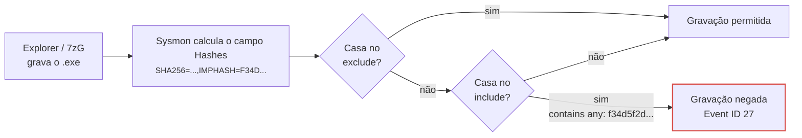
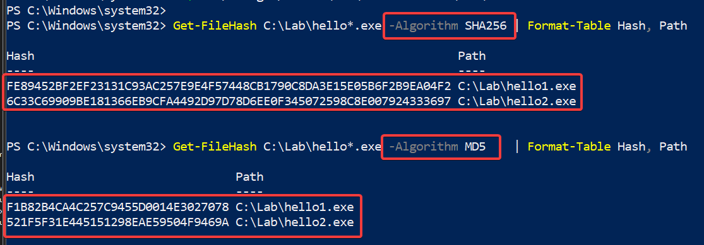

# 1. Introdução

O Sysmon calcula hashes de arquivos em vários eventos (criação de processo, carga de drivers e DLLs, gravação e exclusão de executáveis) e permite usar esses valores tanto para registrar quanto para impedir a gravação de executáveis (a partir da versão 14). Três algoritmos são usados com frequência nessas regras: MD5, SHA-256 e IMPHASH.

Embora os três apareçam lado a lado no mesmo campo do evento, eles medem coisas diferentes. MD5 e SHA-256 são calculados sobre o conteúdo integral do arquivo e identificam uma versão exata. O IMPHASH é calculado sobre a tabela de importações de um executável PE e indica semelhança estrutural entre binários. Essa diferença determina o comportamento de cada um quando usado como critério de filtragem.

Um exemplo concreto da diferença: todo executável .NET Framework compilado apenas em IL (Intermediate Language) importa uma única função, `mscoree.dll!_CorExeMain`. Como o IMPHASH é o MD5 dessa lista de importações normalizada, esses binários compartilham o mesmo valor, independentemente do que fazem:

```powershell
PS> Get-FileHash -Algorithm MD5 -InputStream
([IO.MemoryStream]::new([Text.Encoding]::ASCII.GetBytes('mscoree._corexemain')))

Algorithm       Hash
---------       ----
MD5             F34D5F2D4577ED6D9CEEC516C1F5A744
```

Este artigo cobre:

- como o Sysmon calcula, armazena e compara hashes;
- o algoritmo de cada hash e as propriedades que decorrem dele;
- como o motor de regras avalia a condição `Hashes`, e o efeito de valores de mesmo comprimento;
- o comportamento de `FileBlockExecutable` (EID 27) e `FileExecutableDetected` (EID 29);
- laboratórios para reproduzir cada comportamento em uma VM;
- práticas de configuração e consultas de hunting.

# 2. Como o Sysmon calcula e expõe hashes

O Sysmon calcula apenas os algoritmos listados em `<HashAlgorithms>` e grava todos eles em um único campo de texto, `Hashes`, no formato `ALG=VALOR` separado por vírgulas. Toda regra que filtra por `Hashes` opera sobre essa string concatenada, não sobre campos separados.

```xml
<!-- configuração típica -->
<HashAlgorithms>MD5,sha256,imphash</HashAlgorithms>
```

Valores aceitos: `MD5`, `SHA1`, `SHA256`, `IMPHASH` ou `*` (todos). O resultado em um evento fica assim:

```text
Hashes: MD5=…,SHA256=…,IMPHASH=…
```

Eventos que carregam o campo `Hashes`:

| EID | Evento | O que é hasheado |
| --- | --- | --- |
| 1 | ProcessCreate | a imagem do processo criado |
| 6 | DriverLoad | o driver carregado |
| 7 | ImageLoad | a DLL carregada |
| 15 | FileCreateStreamHash | o conteúdo do ADS (ex.: `Zone.Identifier`) |
| 23 / 26 | FileDelete / FileDeleteDetected | o arquivo apagado |
| 24 | ClipboardChange | o conteúdo da área de transferência |
| 27 | FileBlockExecutable | o executável cuja gravação foi bloqueada |
| 28 | FileBlockShredding | o arquivo protegido contra shredding |
| 29 | FileExecutableDetected | o executável detectado na gravação |

O IMPHASH só existe para arquivos PE. Para conteúdo sem tabela de importações, o Sysmon emite `IMPHASH=00000000000000000000000000000000`, o que já é, por si só, um valor que colide para todo PE sem imports.

# 3. MD5, SHA-256 e IMPHASH em profundidade

MD5 e SHA-256 respondem "este é exatamente o mesmo arquivo?"; o IMPHASH responde "este PE declara depender das mesmas funções, na mesma ordem?". São perguntas diferentes, e só as duas primeiras servem como identidade de arquivo.

## 3.1. MD5

O MD5 gera um resumo de 128 bits (32 caracteres hexadecimais) a partir de todo o conteúdo do arquivo. Qualquer alteração, por menor que seja, muda o resultado, e por isso ele foi durante muitos anos o padrão para identificar arquivos.

O problema é que o MD5 está quebrado criptograficamente desde 2004, quando Wang e colegas demonstraram colisões práticas, ou seja, dois arquivos diferentes com o mesmo hash. Hoje é possível até gerar colisões a partir de um prefixo escolhido, técnica que o malware Flame usou em 2012 para forjar um certificado de assinatura de código da Microsoft.

Na prática, encontrar por acaso dois arquivos com o mesmo MD5 é extremamente improvável, então uma lista de IOCs em MD5 ainda serve para reconhecer amostras conhecidas. O risco aparece quando o adversário tem interesse em produzir a colisão de propósito.

No Sysmon existe um detalhe adicional: o MD5 tem exatamente o mesmo tamanho do IMPHASH. Um valor de 32 caracteres sem o prefixo `MD5=` ou `IMPHASH=` pode ser qualquer um dos dois.

## 3.2. SHA-256

O SHA-256, da família SHA-2, também é calculado sobre todo o arquivo, mas gera um resumo de 256 bits (64 caracteres hexadecimais) e não tem colisões conhecidas. Alterar um único byte, seja um timestamp, a assinatura digital ou um ícone, produz um hash completamente diferente, então cada valor corresponde a uma versão exata de um arquivo.

Essa precisão tem dois lados. É o que torna o SHA-256 confiável para identificar uma amostra específica, e é também o que permite a um atacante gerar uma variante nova só recompilando o binário ou alterando um byte.

No Sysmon, o SHA-256 é o único dos três com tamanho próprio, então não há risco de um valor ser confundido com outro algoritmo no campo `Hashes`.

## 3.3. IMPHASH

Proposto pela Mandiant em 2014, o IMPHASH é o **MD5 de uma string derivada da Import Address Table (IAT)** do PE, não do arquivo. A implementação de referência é a `get_imphash()` da biblioteca `pefile`. VirusTotal e Sysmon produzem o mesmo valor para o mesmo PE:

1. Percorre cada DLL importada, na ordem em que aparece na tabela de importações.
2. Nome da DLL em minúsculas, sem a extensão quando for `.dll`, `.ocx` ou `.sys`.
3. Nome de cada função em minúsculas.
4. Cada entrada vira `dll.funcao`. As entradas são unidas por vírgula, **sem ordenação**.
5. O resultado é o MD5 dessa string.

Para ver isso na prática, foram compilados dois programas C# com comportamentos diferentes, cada um como um EXE .NET:

```cs
// hello1.cs: imprime um texto fixo
class P {
  static void Main() {
    System.Console.WriteLine("lab 1");
  }
}

// hello2.cs: imprime o nome da máquina e a data/hora
class P {
  static void Main() {
    System.Console.WriteLine(System.Environment.MachineName + " " + System.DateTime.Now);
  }
}
```

Resultado dos hashes dos dois binários (O passo a passo está na seção [Laboratório](#laboratorio)):

```python
import pefile
pe = pefile.PE("hello1.exe")
print(pe.get_imphash())
# f34d5f2d4577ed6d9ceec516c1f5a744 (qualquer EXE .NET Framework IL-only)
```

| Tipo de PE | Import típica | IMPHASH |
| --- | --- | --- |
| EXE .NET (IL puro) | `mscoree.dll!_CorExeMain` | `f34d5f2d4577ed6d9ceec516c1f5a744` |
| DLL .NET (IL puro) | `mscoree.dll!_CorDllMain` | `dae02f32a21e03ce65412f6e56942daa` |
| PE sem imports | nenhuma | `00000000000000000000000000000000` (Sysmon) |

# 4. Tabela comparativa

Para bloqueio preventivo, só o SHA-256 combina identidade exata, ausência de colisões conhecidas e comprimento inequívoco dentro do campo `Hashes`.

| Critério | MD5 | SHA-256 | IMPHASH |
| --- | --- | --- | --- |
| Entrada | arquivo inteiro | arquivo inteiro | string normalizada da IAT |
| Tamanho no Sysmon | 32 hex | 64 hex | 32 hex |
| Identifica | uma versão exata | uma versão exata | uma estrutura de importações |
| Arquivos não-PE | sim | sim | não (zeros) |
| Colisão acidental | desprezível | desprezível | comum (.NET, Go, PE sem imports) |
| Colisão intencional | prática (prefixo escolhido) | não conhecida | trivial (copiar a IAT) |
| Evasão pelo atacante | recompilar ou alterar 1 byte | recompilar ou alterar 1 byte | reordenar ou adicionar 1 import |
| Ambíguo sem prefixo no `Hashes` | sim, com IMPHASH | não | sim, com MD5 |
| Custo de cálculo | baixo | baixo | parse do PE + MD5 |
| Uso em `FileBlockExecutable` | aceitável com prefixo `MD5=` e lista de CTI confiável | **recomendado** | **não usar isolado** |
| Uso em detecção / hunting | IOC legado | IOC primário | agrupar famílias, pivotar variantes |

Regra prática: SHA-256 para **bloquear**, IMPHASH para **perguntar**. Um IMPHASH de baixa cardinalidade é um bom pivô de hunting ("quais outros binários no parque têm esta IAT?"); um IMPHASH de alta cardinalidade não serve nem para isso.

# 5. Como a condição `Hashes` é avaliada

O Sysmon não sabe qual algoritmo um valor da lista representa: `contains any` faz busca de substring, sem diferenciar maiúsculas, de cada item separado por `;` contra a string inteira do campo `Hashes`. Um valor de 32 hex casa com MD5 **ou** IMPHASH, o que vier primeiro.

**O IMPHASH genérico casa no include e o driver nega a gravação**



Um EXE .NET legítimo gravado fora dos caminhos excluídos chega ao `include`.
O item `f34d5f2d…` casa como substring do `IMPHASH=`, e o driver nega a criação do arquivo.

Um padrão vulnerável, comum em configurações derivadas de listas de CTI:

```xml
<RuleGroup name="Known Malware Hashes - BLOCK" groupRelation="or">
  <FileBlockExecutable onmatch="include">
    <!-- 32 hex sem prefixo: MD5 ou IMPHASH? ninguém sabe -->
    <Hashes condition="contains any">2eabe9054cad5152567f0699947a2c5b;…;f34d5f2d4577ed6d9ceec516c1f5a744;…</Hashes>
  </FileBlockExecutable>
</RuleGroup>
```

Avaliação contra a gravação de um EXE .NET Framework qualquer:

```text
campo   : MD5=9B1C…,SHA256=4E7A…,IMPHASH=F34D5F2D4577ED6D9CEEC516C1F5A744
item    : f34d5f2d4577ed6d9ceec516c1f5a744
lower() : …,imphash=f34d5f2d4577ed6d9ceec516c1f5a744
                    ^^^^^^^^^^^^^^^^^^^^^^^^^^^^^^^^ substring encontrada → match → EID 27
```

Três propriedades do motor de regras explicam por que o defeito passou despercebido:

1. **Listas de CTI raramente dizem o tipo do hash.** Uma planilha com MD5, SHA-256 e IMPHASH vira uma única coluna de "hashes" no XML. O que tem 64 hex é obviamente SHA-256, o que tem 32 hex fica ambíguo.
2. **O Sysmon não valida semântica.** Ele aceita qualquer string no filtro. Não há aviso de que um valor corresponde a um IMPHASH compartilhado por milhares de binários.
3. **`exclude` vence `include`, mas só se alguém escreveu a exclusão.** No `FileBlockExecutable`, um arquivo que casa com o `RuleGroup` de exclusão não é bloqueado. Exclusões costumam cobrir caminhos de instaladores conhecidos, não software de terceiros instalado em diretórios próprios.

# 6. A correção de sintaxe: prefixar o algoritmo

Como a busca é por substring, incluir o prefixo `ALG=` torna o item inequívoco: `MD5=f34d…` jamais casa com `IMPHASH=F34D…`.

```xml
<Hashes condition="contains any">SHA256=d1b57b6435934414b02330840d93ccb8303d5dadf95a98ac1dc460aa06cc3806;MD5=2eabe9054cad5152567f0699947a2c5b</Hashes>
```

O prefixo resolve a ambiguidade. Se o valor `f34d5f2d…` foi cadastrado de propósito como IMPHASH, `IMPHASH=f34d5f2d…` continuaria bloqueando todo EXE .NET.

# 7. Anatomia do falso positivo

O bloqueio não depende do diretório, do usuário ou do processo que grava o arquivo: depende apenas de o binário ter a IAT mínima do runtime .NET. Por isso, trocar de pasta, de ferramenta de extração ou criar exclusão no antivírus não muda nada.

## 7.1. Cadeia causal

1. Um relatório de CTI ou sandbox sobre uma amostra .NET maliciosa lista MD5, SHA-256 e IMPHASH. Para qualquer amostra .NET IL-only, o IMPHASH é `f34d5f2d…`.
2. Os valores de 32 hex entram na lista de bloqueio sem prefixo.
3. O Sysmon calcula IMPHASH em toda gravação de executável (`<HashAlgorithms>` inclui `IMPHASH`).
4. `contains any` encontra `f34d5f2d…` como substring de `IMPHASH=F34D5F2D…`.
5. O driver nega a gravação e gera o Event ID 27. Nenhuma cópia do arquivo é preservada.
6. Explorer, 7-Zip, instaladores e agentes de atualização recebem erro de acesso. Para o usuário, "o executável não extrai".

## 7.2. Estratégia para o EID 27: bloquear ou só alertar?

O padrão deve ser **alertar** com o Event ID 29 (`FileExecutableDetected`, Sysmon 15+), que usa os mesmos filtros do EID 27 mas apenas registra a criação do executável, sem impedir a gravação. O EID 27 fica reservado para indicadores de altíssima confiança que já passaram por um período em modo alerta. Para ambiente de MSS não é muito recomendado sem esses indicadores.

Três motivos para isso:

1. Um falso positivo no EID 29 é um alerta a mais na fila de triagem. Um falso positivo no EID 27 impede a gravação de um executável legítimo (atualizações, deploys, instaladores), e o efeito aparece como uma atualização ou um instalador que falha, muitas vezes dias depois da regra entrar e sem ligação óbvia com ela. Num MSSP, quem sente o bloqueio é o cliente.
2. O driver do Sysmon decide no momento da gravação, com os campos do próprio evento e um resultado binário. Não há como considerar assinatura digital, processo pai, prevalência no parque ou horário. Essas correlações existem no SIEM. Levar a regra para o EID 29 mantém a mesma telemetria, mas deixa a decisão onde há contexto para tomá-la.
2. O `FileBlockExecutable` checa o cabeçalho PE do arquivo no momento da escrita, através de um minifilter de sistema de arquivos. Não é um limite imposto pelo kernel, e existem bypasses públicos desde o Sysmon 14. Serve para conter ameaças oportunistas, não um adversário que saiba o que está fazendo. Por isso o bloqueio não substitui a detecção.

Um detalhe de nomenclatura: o EID 29 registra a **criação** do executável. A **execução** é o Event ID 1 (`ProcessCreate`). Para "alertar que houve a execução", a regra de detecção deve olhar o EID 1. Para "alertar que o arquivo apareceu no disco", o EID 29.

## 7.3. Qual indicador vai para qual evento

| Indicador | EID 29 (alertar) | EID 27 (bloquear) | Observação |
| --- | --- | --- | --- |
| `SHA256=` de malware confirmado | sim, na entrada | sim, após a fase de alerta | identidade exata, sem colisão conhecida |
| `SHA256=` de driver vulnerável (LOLDrivers) | sim | sim | caso clássico de bloqueio por hash |
| `MD5=` de malware | sim | só com prefixo; prefira converter para SHA-256 | colisões intencionais são viáveis |
| `IMPHASH=` | sim, com correlação no SIEM | **nunca** | similaridade, não identidade |
| `Image` = Office, navegador de PDF, `mshta.exe` gravando executável | sim | candidato forte | comportamento quase sempre malicioso |
| `TargetFilename` em `Temp`, `AppData`, `Public`, `Downloads` | sim | só com exceções maduras | extrações, instaladores e atualizadores legítimos gravam ali |

## 7.4. Uma referência de configuração

A config mantida por Florian Roth e outros no [NextronSystems/sysmon-config](https://github.com/NextronSystems/sysmon-config) (fork da config de SwiftOnSecurity) é uma base madura e amplamente usada, e o arquivo `sysmonconfig-export-block.xml` serve de referência para as escolhas descritas aqui:

- O `<HashAlgorithms>` inclui IMPHASH, mas com o comentário de removê-lo se não for usado para fingerprinting de DLLs. O IMPHASH fica para detecção, não para bloqueio.
- As regras de `FileBlockExecutable` bloqueiam por SHA-256 (a lista de drivers vulneráveis do projeto LOLDrivers) e por caminho (diretórios de staging como `C:\Users\Public\` e `C:\Perflogs\`), nunca por IMPHASH. Todo item de hash vem prefixado com `SHA256=`.
- Os comentários do próprio XML marcam as regras de caminho como passíveis de falso positivo.

A config não é, porém, um bloqueio pronto para produção. O README classifica as regras de bloqueio como "basic blocking rules ... (WARNING: use it with care!)" e recomenda testá-las em um conjunto pequeno de sistemas antes de implantar. Em um MSSP, onde a mesma config vai para vários clientes, a parte de detecção pode entrar com confiança, mas a de bloqueio precisa ser testada por ambiente antes de ligar o EID 27.

```xml
<!-- Fase 1: alerta (mesmo filtro, nenhum impacto operacional) -->
<RuleGroup name="Executable Write - Suspicious Location - DETECT" groupRelation="or">
  <FileExecutableDetected onmatch="include">
    <TargetFilename condition="contains any">\AppData\Local\Temp\;\Users\Public\;\Downloads\</TargetFilename>
  </FileExecutableDetected>
</RuleGroup>

<!-- Fase 2: bloqueio somente do que é inequívoco -->
<RuleGroup name="Executable Write by Office - BLOCK" groupRelation="or">
  <FileBlockExecutable onmatch="include">
    <Image condition="contains any">\winword.exe;\excel.exe;\powerpnt.exe;\outlook.exe</Image>
  </FileBlockExecutable>
</RuleGroup>
```

Na prática, o EID 29 serve de padrão e o bloqueio por EID 27 fica para indicadores que já passaram por uma fase de alerta sem gerar falso positivo. Uma regra de bloqueio que nunca passou por essa fase pode derrubar software legítimo no ambiente.

# 8. Laboratório: reproduzindo o problema e as correções {#laboratorio}

Cinco exercícios demonstram que dois programas .NET diferentes compartilham o IMPHASH, que esse valor bloqueia ambos, e que prefixo, SHA-256 e EID 29 resolvem cada parte do problema.

**Pré-requisitos:** VM Windows 10/11 ou Server 2016+ com snapshot, Sysmon 15+ (schema 4.90), o compilador `csc.exe` do .NET Framework 4.x (já presente no Windows) e, opcionalmente, Python com `pefile`. PowerShell como administrador.

## 8.1. Preparação: dois EXEs .NET diferentes

```powershell
New-Item -ItemType Directory C:\Lab, C:\Lab\pkg -Force | Out-Null

Set-Content C:\Lab\hello1.cs 'class P { static void Main() { System.Console.WriteLine("lab 1"); } }'
Set-Content C:\Lab\hello2.cs 'class P { static void Main() { System.Console.WriteLine(System.Environment.MachineName + " " + System.DateTime.Now); } }'

$csc = "$env:WINDIR\Microsoft.NET\Framework64\v4.0.30319\csc.exe"
& $csc /nologo /out:C:\Lab\hello1.exe C:\Lab\hello1.cs
& $csc /nologo /out:C:\Lab\hello2.exe C:\Lab\hello2.cs

Get-FileHash C:\Lab\hello*.exe -Algorithm SHA256 | Format-Table Hash, Path
Get-FileHash C:\Lab\hello*.exe -Algorithm MD5    | Format-Table Hash, Path
```

<figure style="text-align: center;">
  
  <figcaption>Figura 1. Listagem de hashes SHA-256 e MD5.</figcaption>
</figure>

Os SHA-256 e MD5 serão diferentes entre os dois arquivos. Agora o IMPHASH:

```powershell
py -m pip install pefile
py -c "import pefile,sys; [print(f, pefile.PE(f).get_imphash()) for f in sys.argv[1:]]" C:\Lab\hello1.exe C:\Lab\hello2.exe
# esperado nos dois: f34d5f2d4577ed6d9ceec516c1f5a744
```

<figure style="text-align: center;">
  
  <figcaption>Figura 2. Listagem de hashes IMPHASH iguais.</figcaption>
</figure>

Empacote os binários **antes** de carregar qualquer regra de bloqueio, para reproduzir o sintoma de extração:

```powershell
Compress-Archive C:\Lab\hello1.exe,C:\Lab\hello2.exe C:\Lab\apps.zip -Force
```

Modelo de configuração para todos os exercícios (troque apenas o bloco `RuleGroup`):

```xml
<Sysmon schemaversion="4.90">
  <HashAlgorithms>MD5,SHA256,IMPHASH</HashAlgorithms>
  <EventFiltering>
    <!-- RuleGroup do exercício aqui -->
  </EventFiltering>
</Sysmon>
```

Carregue com `sysmon64.exe -accepteula -i C:\Lab\lab.xml` na primeira vez e `sysmon64.exe -c C:\Lab\lab.xml` nas seguintes.

Configure a seguinte função:

```powershell
function Test-Extract {
  $dest = 'C:\Lab\out'
  Remove-Item $dest -Recurse -Force -ErrorAction SilentlyContinue
  New-Item -ItemType Directory $dest -Force | Out-Null
  Add-Type -AssemblyName System.IO.Compression.FileSystem
  $zip = [IO.Compression.ZipFile]::OpenRead('C:\Lab\apps.zip')
  foreach ($e in $zip.Entries) {
    $out = Join-Path $dest $e.FullName
    try {
      [IO.Compression.ZipFileExtensions]::ExtractToFile($e, $out, $true)
      "OK       $($e.Name)"
    } catch {
      "BLOQUEADO $($e.Name) -> $($_.Exception.Message)"
    }
  }
  $zip.Dispose()
  Get-ChildItem $dest | Select-Object Name, Length
  Get-WinEvent -FilterHashtable @{LogName='Microsoft-Windows-Sysmon/Operational'; Id=27,29; StartTime=(Get-Date).AddMinutes(-2)} -ErrorAction SilentlyContinue |
    Select-Object TimeCreated, Id, @{n='Detalhe';e={($_.Message -split "`n" | Select-String 'RuleName|TargetFilename|Hashes') -join ' | '}} | Format-List
}
```

## 8.2. Exercício 1: valor sem prefixo bloqueia todo EXE .NET

```xml
<RuleGroup name="LAB1 - hash sem prefixo - BLOCK" groupRelation="or">
  <FileBlockExecutable onmatch="include">
    <Hashes condition="contains any">f34d5f2d4577ed6d9ceec516c1f5a744</Hashes>
  </FileBlockExecutable>
</RuleGroup>
```

Execute `Test-Extract`. Resultado esperado: os dois EXEs falham com acesso negado, e há dois Event ID 27 com `RuleName: LAB1…` e `IMPHASH=F34D5F2D…`, apesar de os SHA-256 serem diferentes.

<figure style="text-align: center;">
  
  <figcaption>Figura 3. Evento no SIEM com arquivo bloqueado por hash sem prefixo.</figcaption>
</figure>

## 8.3. Exercício 2: o prefixo desfaz a ambiguidade

Troque o item por `MD5=f34d5f2d4577ed6d9ceec516c1f5a744`. Resultado esperado: extração normal, nenhum EID 27. O mesmo valor, agora declarado como MD5, não casa com o campo `IMPHASH=`.

Troque por `IMPHASH=f34d5f2d4577ed6d9ceec516c1f5a744`. Resultado esperado: os dois voltam a ser bloqueados. O prefixo deixa a intenção explícita, mas não torna seguro um IMPHASH genérico.

## 8.4. Exercício 3: SHA-256 bloqueia só o arquivo certo

```xml
<Hashes condition="contains any">SHA256=<SHA256 do hello1.exe></Hashes>
```

Resultado esperado: `hello1.exe` bloqueado (um EID 27), `hello2.exe` extraído normalmente.

<figure style="text-align: center;">
  
  <figcaption>Figura 4. Dois binários diferentes sendo extraídos do mesmo local e execução do EID 27 e EID 29.</figcaption>
</figure>

## 8.5. Exercício 4: modo alerta com EID 29 e bloqueio com EID 27

```xml
<RuleGroup name="LAB4 - IMPHASH .NET - DETECT" groupRelation="or">
  <FileExecutableDetected onmatch="include">
    <Hashes condition="contains any">IMPHASH=f34d5f2d4577ed6d9ceec516c1f5a744</Hashes>
  </FileExecutableDetected>
</RuleGroup>
<RuleGroup name="LAB4 - MD5 hash - BLOCK" groupRelation="or">
  <FileBlockExecutable onmatch="include">
    <Hashes condition="contains any">MD5=521F5F31E445151298EAE59504F9469A</Hashes>
  </FileBlockExecutable>
</RuleGroup>
```

Resultado esperado: `hello1.exe` é registrado e o `hello2.exe` é bloqueado.

# 9. Recomendações de engenharia de detecção

Bloqueie por identidade, detecte por similaridade, e faça a ferramenta de publicação recusar o que foge disso.

## 9.1. Estrutura da configuração

```xml
<HashAlgorithms>MD5,SHA256,IMPHASH</HashAlgorithms>

<!-- BLOQUEIO: identidade exata, sempre com prefixo, após fase de alerta -->
<RuleGroup name="Known Malware SHA256 - BLOCK" groupRelation="or">
  <FileBlockExecutable onmatch="include">
    <Hashes condition="contains any">SHA256=<sha256_1>;SHA256=<sha256_2></Hashes>
  </FileBlockExecutable>
</RuleGroup>

<!-- ALERTA: similaridade estrutural e indicadores em avaliação -->
<RuleGroup name="Suspicious IMPHASH - DETECT" groupRelation="or">
  <FileExecutableDetected onmatch="include">
    <Hashes condition="contains any">IMPHASH=<imphash_baixa_cardinalidade></Hashes>
  </FileExecutableDetected>
</RuleGroup>

<!-- EXCEÇÕES: por identidade, nunca por pasta -->
<RuleGroup name="Approved Software - EXCLUDE" groupRelation="or">
  <FileBlockExecutable onmatch="exclude">
    <Hashes condition="contains any">SHA256=<sha256_software_aprovado></Hashes>
  </FileBlockExecutable>
</RuleGroup>
```

Princípios:

- **Um algoritmo por `RuleGroup`**, com o algoritmo e a ação (BLOCK/DETECT) no nome. O `RuleName` do evento passa a explicar sozinho o motivo.
- **Prefixo obrigatório** (`SHA256=`, `MD5=`, `IMPHASH=`) em todo item de `Hashes`.
- **IMPHASH nunca no EID 27.** Só em EID 29 ou EID 1, com a decisão tomada no SIEM.
- **Antes de usar um IMPHASH, meça a cardinalidade**: consulte o valor como IMPHASH no VirusTotal e no próprio parque. Se aparece em binários não relacionados, ele não identifica nada.
- **Exceções por `SHA256=`**, não por caminho: exceção por pasta abre aquele diretório para qualquer binário.
- **Nomes honestos.** "Executable Write Blocked by Hash" descreve o EID 27; "Malware Execution Detected" induz o analista ao erro.
- **Mesmo `HashAlgorithms` em todo o parque**, conferido pelo Event ID 16 após cada publicação.

## 9.2. Lint no pipeline de publicação

A configuração do Sysmon costuma ser versionada e distribuída para muitos hosts de uma vez. Os erros que geram os falsos positivos deste artigo (um hash de 32 caracteres sem prefixo, um IMPHASH de alta cardinalidade, um IMPHASH numa regra de bloqueio) não saltam aos olhos em revisão manual e passam para produção com facilidade. Um lint que roda no pipeline que publica a configuração barra esses casos antes de a config chegar aos endpoints.

O script abaixo percorre cada `<Hashes>` do XML e recusa: item sem prefixo de algoritmo, comprimento incoerente com o algoritmo declarado, IMPHASH de alta cardinalidade conhecido e qualquer IMPHASH em regra de bloqueio. Ele sai com código 1 ao encontrar qualquer um desses casos, o que interrompe a etapa de publicação num pipeline de CI.

```python
#!/usr/bin/env python3
"""Lint de <Hashes> em configuracoes Sysmon. Uso: sysmon_hash_lint.py config.xml"""
import re, sys, xml.etree.ElementTree as ET

HIGH_CARDINALITY_IMPHASH = {
    "f34d5f2d4577ed6d9ceec516c1f5a744",  # .NET EXE  (mscoree._corexemain)
    "dae02f32a21e03ce65412f6e56942daa",  # .NET DLL  (mscoree._cordllmain)
    "00000000000000000000000000000000",  # PE sem imports (Sysmon)
}
PREFIXED = re.compile(r"^(MD5|SHA1|SHA256|IMPHASH)=([0-9a-f]+)$", re.I)
LEN = {"MD5": 32, "SHA1": 40, "SHA256": 64, "IMPHASH": 32}

errors = 0
for parent in ET.parse(sys.argv[1]).getroot().iter():
    for h in parent.findall("Hashes"):
        blocking = parent.tag in ("FileBlockExecutable", "FileBlockShredding")
        for item in filter(None, (i.strip() for i in (h.text or "").split(";"))):
            m = PREFIXED.match(item)
            if not m:
                print(f"[ERRO] {parent.tag}: sem prefixo de algoritmo: {item}"); errors += 1; continue
            alg, val = m.group(1).upper(), m.group(2).lower()
            if len(val) != LEN[alg]:
                print(f"[ERRO] {parent.tag}: {alg} com {len(val)} hex: {item}"); errors += 1
            if alg == "IMPHASH" and val in HIGH_CARDINALITY_IMPHASH:
                print(f"[ERRO] {parent.tag}: IMPHASH generico: {item}"); errors += 1
            if blocking and alg == "IMPHASH":
                print(f"[ERRO] {parent.tag}: IMPHASH nao pode bloquear: {item}"); errors += 1
sys.exit(1 if errors else 0)
```

A lista `HIGH_CARDINALITY_IMPHASH` deve crescer com o tempo: todo IMPHASH que gerar falso positivo em alerta entra nela.

# 10. Referências

Os valores `md5("mscoree._corexemain") = f34d5f2d4577ed6d9ceec516c1f5a744` e `md5("mscoree._cordllmain") = dae02f32a21e03ce65412f6e56942daa`, além do comportamento do lint, foram reproduzidos localmente.

- [Tracking Malware with Import Hashing](https://cloud.google.com/blog/topics/threat-intelligence/tracking-malware-import-hashing) — Mandiant, 2014: definição original do IMPHASH e efeito da ordem de compilação na IAT.
- [Limitations of ImpHash in DFIR](https://www.cybertriage.com/blog/limitations-of-imphash-in-dfir) — Cyber Triage: IMPHASHs de alta cardinalidade, incluindo `f34d5f2d…` (.NET, `_CorExeMain`) e binários Go.
- [Classifying Malware using Import API and Fuzzy Hashing (impfuzzy)](https://blogs.jpcert.or.jp/en/2016/05/classifying-mal-a988.html) — JPCERT/CC, 2016: fragilidade do IMPHASH a imports adicionados.
- [Microsoft Sysmon can now block malicious EXEs from being created](https://www.bleepingcomputer.com/news/microsoft/microsoft-sysmon-can-now-block-malicious-exes-from-being-created/) — BleepingComputer: introdução do `FileBlockExecutable` e do Event ID 27 no Sysmon 14.
- [Microsoft Sysmon 14.0 Brings New Security Feature to Block Malware](https://petri.com/microsoft-sysmon-14-0-block-malware/) — Petri: critérios de bloqueio (nome, caminho, hash) e bypass público do recurso.
- [Managed Execution Process](https://learn.microsoft.com/en-us/dotnet/standard/managed-execution-process) — Microsoft Learn: compilação para CIL, metadados e compilação JIT pelo CLR.
- [\_CorExeMain Function](https://learn.microsoft.com/en-us/dotnet/framework/unmanaged-api/hosting/corexemain-function) — Microsoft Learn: ponto de entrada do `mscoree.dll` que inicia o CLR em executáveis gerenciados (.exe).
- [\_CorDllMain Function](https://learn.microsoft.com/en-us/dotnet/framework/unmanaged-api/hosting/cordllmain-function) — Microsoft Learn: ponto de entrada do `mscoree.dll` que inicia o CLR em DLLs gerenciadas.

---



Por favor, entre em contato comigo pelo meu <a href="https://www.linkedin.com/in/sandsoncosta">LinkedIn</a>.<br>Vou ficar muito contente em receber um feedback seu.

